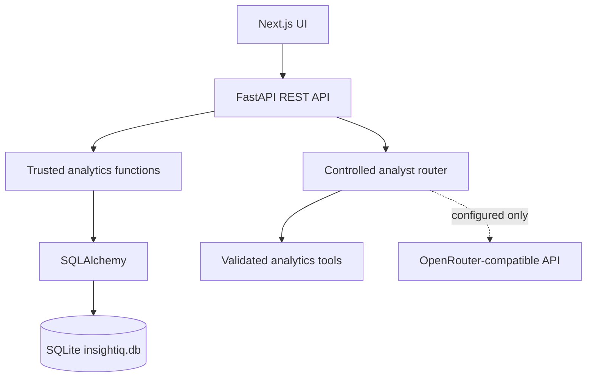

# InsightIQ

InsightIQ is an AI-assisted business intelligence application for e-commerce and retail teams, built for the DDL LABS AI / Python / LLM Engineer take-home assignment.

## Contents

- [Overview](#overview)
- [Features](#features)
- [Stack](#stack)
- [Architecture](#architecture)
- [Setup](#setup)
- [Environment](#environment)
- [Database](#database)
- [CSV import](#csv-import)
- [API](#api)
- [AI analyst](#ai-analyst)
- [Testing](#testing)
- [Limitations](#limitations)
- [Submission](#submission)

## Overview

InsightIQ lets business users ask questions about revenue, orders, products, categories, and customers. Numerical answers are calculated from SQLAlchemy database records; the frontend does not fabricate KPI or chart values.

## Features

Implemented:

- Overview dashboard with revenue, order, category, and product analytics.
- Sales, customer, product, and category analytics APIs and workspaces.
- Customer segmentation, search, pagination, detail history, and customer lifetime revenue.
- Product and category ranking, contribution, stock, sales, detail, and trend data.
- Pandas CSV ingestion for categories, products, customers, orders, and order items.
- ISO datetime conversion, duplicate handling, validation errors, transactions, and import history.
- Deterministic AI Analyst routing for core revenue, product, category, chart, and decline questions.
- OpenRouter-compatible bounded tool-calling path when configured.
- Completed-calendar-month revenue comparison and evidence report.
- CSV report exports for sales, products, and customers.

Partial or unverified:

- A live OpenRouter request was not verified because no provider key/model was configured.
- Navigation uses dedicated rendered workspaces inside the main App Router page rather than separate URL subroutes.
- Reports and Settings screens are lighter than the full assignment specification.

## Stack

| Area | Actual technology |
|---|---|
| Frontend | Next.js 15.1.4, React 19, TypeScript |
| Charts | Recharts 2.15.0 |
| Backend | Python 3.11, FastAPI, Uvicorn |
| ORM | SQLAlchemy 2.0 |
| Data | Pandas |
| Configuration | Pydantic Settings |
| HTTP/LLM | HTTPX |
| Database | SQLite by default |
| Tests | Pytest, FastAPI TestClient |
| Runtime | Docker Compose |

Tailwind CSS, shadcn/ui, Framer Motion, Vitest, and React Testing Library are not installed in the current repository.

## Architecture



## Setup

### Docker Desktop

Start Docker Desktop's Linux engine:

```powershell
cd C:\Users\Admin\Documents\ddllabs
docker compose up --build
```

URLs:

- Frontend: http://localhost:3000
- Backend: http://localhost:8000
- Swagger: http://localhost:8000/docs

Stop services with `docker compose down`.

The backend creates the SQLite schema and deterministic demo data when the database is empty.

### Local Windows setup

Backend:

```powershell
cd C:\Users\Admin\Documents\ddllabs\backend
copy .env.example .env
python -m venv .venv
.\.venv\Scripts\Activate.ps1
python -m pip install -r requirements.txt
python -m uvicorn app.main:app --reload
```

Frontend, in a second terminal:

```powershell
cd C:\Users\Admin\Documents\ddllabs\frontend
npm.cmd install
npm.cmd run dev
```

## Environment

Copy `backend/.env.example` to `backend/.env`:

```dotenv
DATABASE_URL=sqlite:///./insightiq.db
OPENROUTER_API_KEY=
LLM_MODEL=
LLM_BASE_URL=https://openrouter.ai/api/v1
FRONTEND_URL=http://localhost:3000
SECRET_KEY=change-me
BUSINESS_TIMEZONE=Asia/Kolkata
DEFAULT_CURRENCY=INR
INACTIVE_CUSTOMER_DAYS=90
```

- `DATABASE_URL`: SQLAlchemy database URL; SQLite is the verified default.
- `OPENROUTER_API_KEY`, `LLM_MODEL`, `LLM_BASE_URL`: optional OpenRouter-compatible provider configuration.
- `FRONTEND_URL`: allowed CORS origin.
- `SECRET_KEY`: reserved application secret configuration.
- `BUSINESS_TIMEZONE`: reporting timezone.
- `DEFAULT_CURRENCY`: display currency.
- `INACTIVE_CUSTOMER_DAYS`: default customer inactivity threshold.

Never commit real secrets.

## Database

Models are defined in `backend/app/db.py`:

- Categories: name and description.
- Products: product code, name, category, price, stock, and created timestamp.
- Customers: customer code, name, email, city, and created timestamp.
- Orders: order number, customer, date, status, shipping, discount, tax, and created timestamp.
- Order items: order, product, quantity, unit price, item discount, and created timestamp.
- Import batches: file, dataset, counts, status, errors, and timestamp.

Relationships: orders reference customers; products reference categories; order items reference orders and products.

Revenue methodology:

```text
item revenue = quantity × unit_price − item_discount
```

Only `completed` orders contribute to sales analytics. Refunds are not modeled separately. Order-level charges are not included in grouped item revenue calculations.

## CSV import

Dependency order:

```text
categories → products → customers → orders → order_items
```

Required columns:

| Dataset | Required columns |
|---|---|
| categories | `name` |
| products | `product_code`, `name`, `category_id`, `price` |
| customers | `customer_code`, `name`, `email` |
| orders | `order_number`, `customer_id`, `order_date`, `status` |
| order_items | `order_id`, `product_id`, `quantity`, `unit_price` |

Pandas validates structure and values, converts ISO datetimes into Python `datetime`/`date` objects, detects duplicates, validates relationships through the database, and commits each import transactionally. Invalid rows return row/field errors; duplicate keys are reported and skipped.

## API

Interactive documentation: http://localhost:8000/docs

```text
GET  /api/v1/health
GET  /api/v1/health/database
GET  /api/v1/dashboard/overview
GET  /api/v1/dashboard/trends
GET  /api/v1/sales/metrics
GET  /api/v1/sales/monthly-revenue
GET  /api/v1/sales/daily-revenue
GET  /api/v1/sales/category-revenue
GET  /api/v1/sales/comparison
GET  /api/v1/customers/metrics
GET  /api/v1/customers
GET  /api/v1/customers/top
GET  /api/v1/customers/inactive
GET  /api/v1/customers/trends
GET  /api/v1/customers/{customer_id}
GET  /api/v1/products/metrics
GET  /api/v1/products
GET  /api/v1/products/top
GET  /api/v1/products/low-performing
GET  /api/v1/products/{product_id}
GET  /api/v1/categories/metrics
GET  /api/v1/categories/revenue
GET  /api/v1/categories
GET  /api/v1/categories/{category_id}
POST /api/v1/ai/chat
POST /api/v1/data/upload
GET  /api/v1/data/imports
GET  /api/v1/data/imports/{import_id}
GET  /api/v1/insights
POST /api/v1/insights/generate
GET  /api/v1/reports/sales
GET  /api/v1/reports/products
GET  /api/v1/reports/customers
```

Example:

```powershell
$body = @{ message = 'show top 5 products by revenue' } | ConvertTo-Json
Invoke-RestMethod http://localhost:8000/api/v1/ai/chat -Method Post -ContentType 'application/json' -Body $body
```

## AI analyst

The workflow is: receive a question, identify a supported intent, execute a trusted analytics operation, return structured database-backed data/tool metadata, and summarize the result.

With OpenRouter configured, the backend sends an OpenAI-compatible bounded tool schema. The live provider path was not verified because no key/model was configured. Without it, deterministic core routing remains available and reports `llm_used: false`. Arbitrary SQL and model-generated Python are never executed.

## Analytics

Implemented calculations include total revenue, orders, AOV, daily/monthly revenue, revenue by category/product, top products by revenue and quantity, new/repeat/active/inactive customers, customer lifetime revenue, product/category rankings, contribution percentages, and completed-calendar-month comparisons. Zero-denominator changes return an explanation instead of a fabricated value.

## Testing

Run the verified backend suite:

```powershell
docker compose exec -T backend sh -c "rm -f test.db && DATABASE_URL=sqlite:///./test.db pytest -q"
```

Latest verified result: `8 passed`, with three FastAPI deprecation warnings. Tests cover health, overview, chat routing, CSV datetime persistence/rejection, revenue decline, product analytics, and category analytics.

The frontend production build runs inside its Dockerfile with `npm run build`; TypeScript validation has also been run locally.

## Known limitations

- SQLite is the verified database; PostgreSQL deployment is not independently verified.
- Refunds and separate order-level accounting are not modeled.
- OpenRouter credentials/model were unavailable for live verification.
- Authentication, authorization, rate limiting, and production monitoring are not implemented.
- Navigation uses dedicated rendered workspaces inside the main App Router page rather than separate URL routes.
- Reports and Settings remain lighter than the full specification.
- Cost price/profitability is unavailable in the current schema and is not fabricated.

## Future improvements

- PostgreSQL migrations and production deployment.
- Authentication, workspaces, and authorization.
- Refund/order-level accounting.
- Full multi-turn provider-backed orchestration.
- Frontend component tests, observability, rate limiting, and background imports.

## Assignment submission

```text
Candidate Name: John Die
Project: InsightIQ
Role: AI / Python / LLM Engineer
Assignment: DDL LABS AI Data Analyst & Business Intelligence Agent
GitHub Repository: [Add repository URL]
Demo Video: [Add demo URL]
LLM Used: OpenRouter-compatible API path; live model not verified
Database Used: SQLite (sqlite:///./insightiq.db)
Main Technologies: Next.js, React, TypeScript, FastAPI, Python, SQLAlchemy, Pandas, Recharts, Docker
Known Limitations: See the Known limitations section above
```

